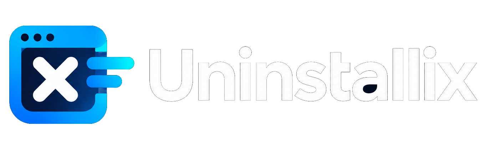

  

  <b>Uninstaller and cleaner for Windows 10 and 11</b> 
  Uninstall programs cleanly, clear caches and free up space, without leaving anything behind.

  <a href="https://github.com/alexyxcfghv2/Uninstallix/releases/latest/download/Uninstallix-Setup.exe">
    <b>⬇️ Download Uninstallix-Setup.exe</b>
  </a>

  No install wanted? <a href="https://github.com/alexyxcfghv2/Uninstallix/releases/latest/download/Uninstallix-Portable.exe">Download the portable version</a>. 
  Available in English and French: the app follows your Windows language.

## Installation

1. Download **Uninstallix-Setup.exe** with the link above.
2. Double-click it and accept the Windows permission prompt.
3. Pick the install folder and shortcuts, then click **Install**.

Nothing else to install: everything is included. Uninstallix tells you by itself when a new version is out.

## What Uninstallix does

- **Programs**: list with size and date, search, sorting, uninstall one or several programs in a row,
  then scan for leftovers (files, folders, registry). Nothing is deleted without your approval, and essential
  Windows components are protected.
- **Cleanup**: caches of FiveM, Discord, Chrome, Edge, Steam, Roblox, shaders, temporary files and the Recycle Bin,
  each one explained, with a preview of what will be deleted and profiles (Gaming, Browsers, Custom). Frees RAM and
  flushes the DNS cache.
- **Forgotten leftovers**: find folders left behind by programs you already uninstalled, and review them before cleaning.
- **Startup**: see the apps that start with Windows and turn them off in one click.
- **Disk space**: find what takes the most room, and see what grew since your last analysis.
- **History**, **protected favorites**, an optional **cleanup reminder** and **settings** (restore point, Recycle Bin,
  animations, language…).

## License

© 2026 alexy. **All rights reserved.** Free for personal use; copying, modifying and redistributing are
forbidden without permission. See [LICENSE](LICENSE).
